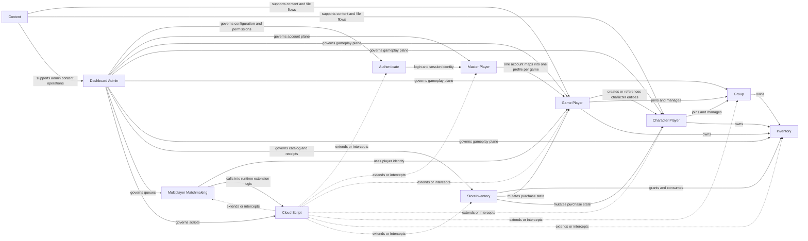

# Domain Relationship Map

This document explains how the client SDK organizes GearN server domains and how a consuming Unity project should think about them.

## Core Domain Graph

## Short Meaning Of Each Domain

### Authenticate

- login
- account registration
- external identity linking and unlinking
- token refresh and auth validation

### MasterPlayer

- global account-level identity across games
- account plane data
- external account bindings and push or email related data

### GamePlayer

- per-game gameplay profile
- main runtime player state for a game
- currencies, statistics, data, segments, tags, friends, group refs, and inventory refs

### CharacterPlayer

- character-scoped gameplay profile inside one game
- same broad style of mutable data as `GamePlayer`, but scoped to a character entity

### Group

- shared member container
- group-owned gameplay state
- group chat and membership update event relationships

### Inventory

- concrete inventory item state
- owned by player, character, or group

### Content

- content-facing and upload-facing flows
- download helpers and content metadata operations

### StoreInventory

- public SDK name for the purchase and store-catalog domain
- store item definition, purchase, gift, receipt validation, usage tracking, and store logs
- this is the client-facing contract name that maps to server `RequestType.StoreInventory`

### Dashboard Admin

- admin and control-plane domain
- game configuration, secret info, permissions, analytics, and maintenance operations

### Multiplayer Matchmaking

- queue, ticket, and match lifecycle
- player matching and runtime match metadata

### Cloud Script

- versioned script management and execution
- runtime extension point that can be called from many other domains

## Practical Rules

- If a change starts from login or identity, begin with `Authenticate` and then follow into `MasterPlayer`
- If a change is gameplay state inside one game, begin with `GamePlayer`
- If a change is character-bound, move from `GamePlayer` into `CharacterPlayer`
- If a change is purchase or receipt flow, inspect `StoreInventory` together with the target mutation domain
- If a change is operational or permission-oriented, inspect `Dashboard`
- If a change is runtime extension logic, inspect `CloudScript`